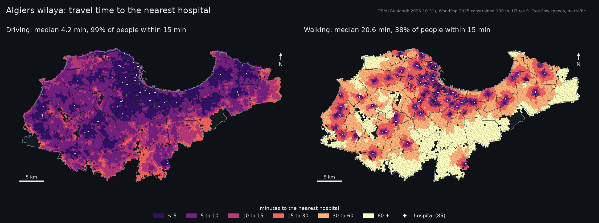
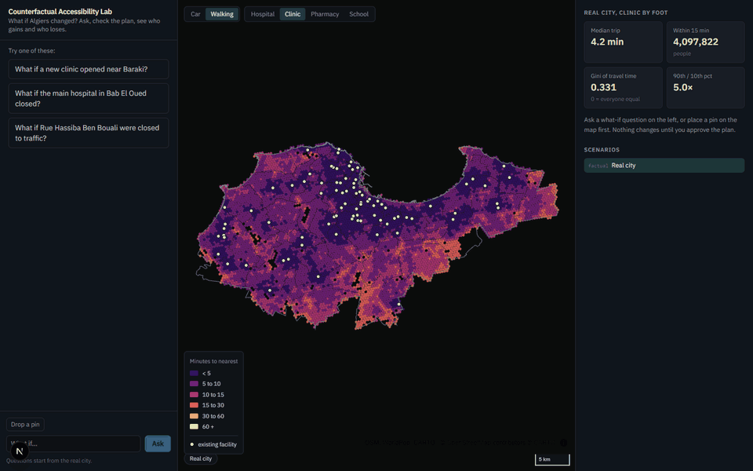
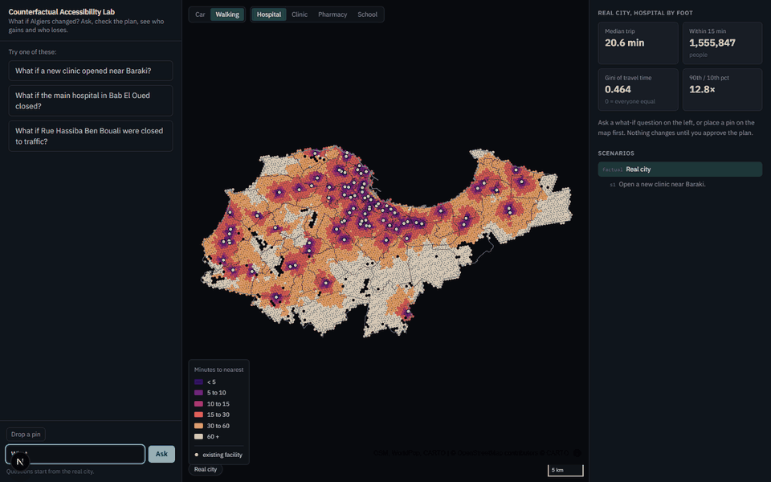
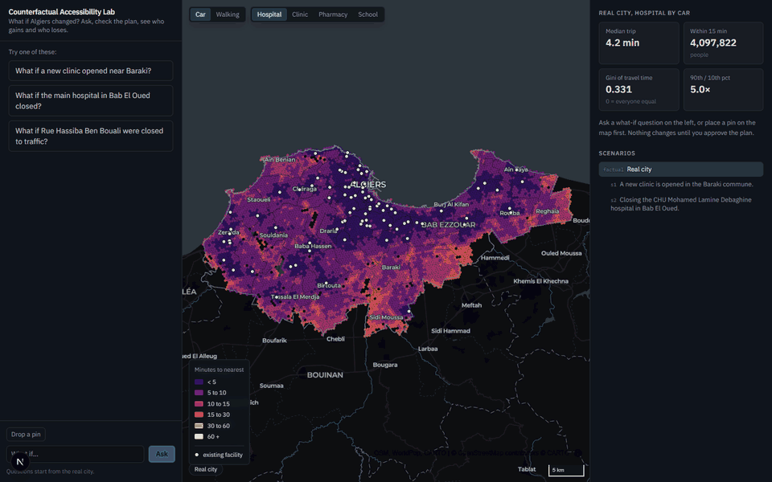

# Counterfactual Accessibility Lab

Ask a what-if question about Algiers in plain language. The agent turns it into a list of edits to a sandboxed copy of the city, shows you the plan, and after you approve it computes access to hospitals, clinics, pharmacies and schools for the real city and the changed one. It then explains who gains, who loses, by how much, and whether access becomes more or less equal.

Live: https://counterfactual-lab-omega.vercel.app (API on a free server, so the first request after a quiet spell can take a minute to wake it).

The LLM plans and explains. Code computes. Every number in the explanation is checked against stored results before you see it. The real city is never modified.



## Three demos

Recorded from the running app with `scripts/record_demos.py`. Each one: ask, approve the plan, watch the reach of the change grow, swipe between the real city and the scenario, then the difference map (blue faster, orange slower).

**A new clinic near Baraki.** Walking access to a clinic: 13,237 people faster, nobody slower, up to 4.4 minutes saved.



**Closing the main hospital in Bab El Oued** (CHU Mohamed Lamine Debaghine). Walking access to a hospital: 24,964 people slower, 4,338 no longer within 15 minutes, up to 12.1 minutes more.



**Closing Rue Hassiba Ben Bouali to cars.** The agent closes every segment and spelling of the street, for cars only; walking is untouched. The map shows the layer that changes most, clinics by car: 11,185 people slower and 1,781 no longer within 15 minutes, mostly in Sidi M'Hamed, Belouizdad and Alger-Centre. For hospitals by car it is 10,284 slower and 1,781.



## What you can ask

- "What if a new clinic opened near Baraki?"
- "What if the main hospital in Bab El Oued closed?"
- "What if Rue Hassiba Ben Bouali were closed to traffic?"
- "What if a road connected these two pins?" (drop pins on the map first)
- "Now also close this road" (builds on the scenario you are looking at)

Five edit types: open a facility, close a facility, add a road, close a road or an area, upgrade driving speed on a road or area (road speed upgrade). Two modes: driving and walking.

## How it works

```
question
  -> interpret   LLM with two tools: search_places, nearby_facilities. Writes a plan that
                 refers to places by ref (p1, click1) and to streets by name. It never
                 writes coordinates and never picks road segments.
  -> validate    code: refs exist, points inside the wilaya and within 300 m of a road,
                 a named street resolves to every segment and spelling of it, an area
                 closure is refused when the question names a street, "closed to
                 traffic" closes it to cars only, nothing large gets cut off.
                 One repair round.
  -> confirm     LangGraph interrupt. You approve, edit or cancel the plan.
  -> apply       copy-on-write branch of the scenario tree
  -> compute     travel times, coverage, E2SFCA, equity for every populated H3 cell
  -> compare     per-cell change, summary deltas, communes that gain and lose
  -> narrate     LLM writes 4 to 6 sentences. Any number not in the computed facts is
                 rejected and the LLM rewrites once; after that a plain template is used.
```

The LLM is called two to three times per scenario, never inside a metric loop. Each run keeps a provenance log of every tool call, LLM call, validation result and timing (`GET /api/scenarios/{id}/provenance`).

## Data

All sources were checked before use. Counts are from `scripts/fetch_data.py` on 2026-11-01.

| Input | Source | Result |
|---|---|---|
| Study area | OSM relation 157062, Wilaya d'Alger | 770.9 km² |
| Road network | Geofabrik Algeria extract 2026-10-31, built with OSMnx's own filters | drive: 54,010 nodes, 131,721 edges. walk: 81,811 nodes, 220,680 edges |
| Facilities | OSM `amenity` and `healthcare` tags | 123 hospital points (85 after merging), 859 clinics, 757 pharmacies, 1,328 schools |
| Population | WorldPop 2025 constrained 100 m (R2025A) | 4,121,898 people in 7,240 H3 cells (res 9, 201 m edge) |
| Communes | OSM admin level 8 | 56 polygons |

Notes from checking the data:

- A name search for "Algiers Province" in Nominatim returns the wilaya office building, so the boundary is pinned by relation id and the fetch fails if the area is under 500 km².
- The public Overpass servers were overloaded or refusing requests during development, so OSM data comes from a pinned Geofabrik extract parsed locally with pyosmium. The graphs go through the same build steps as `ox.graph_from_polygon`.
- OSM maps many hospital departments as separate hospitals ("urgences pédiatriques", "consultation d'hématologie"). Hospital points within 250 m are merged into one: 123 points become 85.
- No hospital in the data has a `beds` tag, so E2SFCA uses equal capacity for every facility.
- Communes cover 743.6 of 770.9 km². About 112,000 people live in cells outside any commune polygon and are assigned to the nearest commune. Algiers has 57 communes; one is missing from OSM.

Metric work uses EPSG:32631 (WGS 84 / UTM 31N).

## Metrics

For each populated H3 cell, each facility type and each mode:

- travel time to the nearest facility
- people within 10, 15 and 30 minutes
- number of facilities within the catchment (cumulative opportunities)
- enhanced 2SFCA (E2SFCA) with Gaussian distance decay, per 10,000 people, summarised by its population-weighted median and Gini. The population-weighted mean is not reported: for any 2SFCA it equals total supply over total population, so it cannot show who gains or loses
- population-weighted Gini of travel time and the 90th / 10th percentile ratio
- per-cell change, people gaining and losing, communes gaining and losing most

Travel time = walk from the cell centre to a street node + network time + walk from a street node to the facility. Each cell and facility links to up to four street nodes: the nearest, plus any within 300 m. The best one is used. Links are fixed by the real city, so closing a road can only lengthen trips and adding one can only shorten them. Motorway nodes are not used for access. A cell more than 1 km from any road counts as unreachable (4,228 people for driving, 1,765 for walking).

E2SFCA follows Luo and Qi (2009) with the Gaussian weight of Dai (2010): inside a catchment of d0 minutes, a trip of t minutes has weight (exp(-0.5 (t/d0)²) − exp(-0.5)) / (1 − exp(-0.5)), which is 1 at the door and 0 at the edge. The catchment is 30 minutes for hospitals by car and 15 minutes for everything else (walking, and clinics, pharmacies and schools by car). Every facility has the same capacity (see Limitations).

Sensitivity: the catchment only affects the E2SFCA scores and the count of facilities in reach; travel-time headlines do not depend on it. Rerunning the three demos at 10, 15, 20 and 30 minutes (`scripts/demo_numbers.py --sensitivity`, `docs/sensitivity.json`) confirms this: the same people get faster or slower trips at every catchment, and the E2SFCA Gini moves the same way; only the road closure's median E2SFCA score changes sign, falling slightly at 10 to 20 minutes and rising slightly at 30.

Snapping: cells use H3 resolution 9 (201 m edge). Weighted by population, the distance from a cell centre to its nearest street node is 43 m median and 204 m at the 95th percentile for driving, and 36 m and 130 m for walking. Unweighted, per cell, it is 110 m and 615 m for driving and 80 m and 445 m for walking. That distance is walked at 4.5 km/h at the start of every trip, in both modes. It matters for the threshold counts: without it, the hospital closure would put 1,040 people outside a 15 minute walk instead of 4,338, and the clinic would bring 1,991 people within 15 minutes instead of none. Trip counts and the largest changes barely move.

Speeds: driving uses OSMnx speed imputation (posted `maxspeed`, else the mean for that road class, e.g. 30.9 km/h for residential). Walking is 4.5 km/h everywhere.

## Validation

`uv run pytest` runs 23 tests.

- **Hand-built network** (`backend/tests/toy.py`): a line of nodes 1 km apart where every time can be worked out by hand. One test per edit type, plus scenario chaining, validation messages, the factual city never changing, copy-on-write, re-linking cut-off cells, E2SFCA values and Gaussian weights, and Gini on known inputs.
- **Real data properties**: adding a hospital never slows any cell; removing one never speeds any cell; adding a road never slows any cell; closing every motorway never speeds any cell.
- **Cross-check**: travel times for 300 random cells per mode match NetworkX Dijkstra on the same graph exactly.
- **Agent**: with a scripted model, a full run through the interrupt, a repair round, cancel, a plan that cannot be repaired, and the number check rejecting an invented figure.
- **API**: ask, confirm, metrics, compare, edit geometry, isochrone and scenario tree over HTTP.

## Routing benchmark

`scripts/benchmark.py`, nearest hospital for every node and every hospital's 15 minute catchment, Intel i7 13th gen laptop, no GPU:

| Engine | drive build | drive nearest | drive catchments | matches NetworkX |
|---|---|---|---|---|
| scipy csgraph | 0.03 s | 0.02 s | 0.67 s | exactly |
| igraph | 0.18 s | 0.09 s | | exactly |
| NetworkX | 0.70 s | 0.33 s | | reference |
| pandana | 204 s | 1.44 s | 1.76 s | within 0.05 s |

Every counterfactual changes the graph, so build time matters most. pandana's contraction hierarchy takes over three minutes to build for the drive graph. The lab uses scipy.

## Runtime

Measured on the same laptop after caching:

| Step | Time |
|---|---|
| Server start (load city, cached baseline) | 6 s |
| Factual baseline, all 8 mode and type pairs | 22 s, once, cached to disk |
| Facility edit (one type recomputed) | about 7 s |
| Road edit for cars (four types recomputed) | about 18 s |
| LLM planning | 2 to 5 s, more when the provider is busy |
| LLM narrative | about 1 s |

Results are cached per network state and facility set, so only what an edit touches is recomputed.

The live demo runs on Render's free tier (0.15 CPU, 512 MB). There a facility scenario takes about 35 s to plan and 35 s to compute; a road edit takes a few minutes. Peak memory is about 450 MB.

## Limitations

- **OSM completeness.** Facilities are what volunteers mapped. Some clinics and pharmacies are missing; some points are departments, not facilities. Names are often missing (342 of 757 pharmacies have one).
- **No traffic.** Driving times are free flow. Real peak-hour times in Algiers are much longer, so driving access is optimistic.
- **No capacity data.** E2SFCA treats every facility of a type as equal. A university hospital and a small polyclinic count the same.
- **Speed assumptions.** Imputed speeds by road class, one walking speed for everyone, no slopes, no crossings.
- **Population** is a modelled 2025 estimate, not a census.
- **Nearest facility only** for travel time. People do not always go to the nearest one.

## Future work

- A public transport layer (bus and tram lines with stops, headways and waiting time). The road speed upgrade edit only changes car speeds and does not model transit.

## Run it

```bash
uv sync
uv run python scripts/fetch_data.py        # about 6 minutes, downloads 370 MB
uv run python scripts/precompute_factual.py
cp .env.example .env                       # add a model key
uv run uvicorn backend.api.app:app --port 8000
cd frontend && npm install && npm run dev  # http://localhost:3000
```

Deploy: the `Dockerfile` builds the API and pulls the runtime data from the `data-2026-10-31` release. The frontend needs `NEXT_PUBLIC_API_URL`, and the API needs `ALLOWED_ORIGINS` set to the frontend's URL.

`LAB_MODEL` takes any LangChain `init_chat_model` string, for example `google_genai:gemini-3.1-flash-lite`. Install the matching provider package. Set `LANGSMITH_TRACING=true` and `LANGSMITH_API_KEY` to trace runs.

One question from the command line:

```bash
uv run python scripts/run_scenario.py "What if a new clinic opened near Baraki?"
```

## Layout

```
backend/
  agent/     LangGraph graph, plan schema, prompts, number check, fact sheet
  network/   loading, edits, scenario tree, validation
  metrics/   travel times, E2SFCA, equity, comparison
  geocode/   local name search, rate-limited Nominatim
  api/       FastAPI with server-sent events
  tests/
frontend/    Next.js, MapLibre, deck.gl
scripts/     fetch_data, precompute_factual, benchmark, run_scenario
data/        README only; everything else is generated
```

Data: OpenStreetMap contributors (ODbL), WorldPop (CC BY 4.0). Basemap: CARTO.
